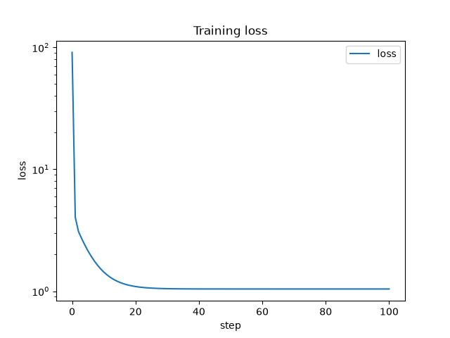
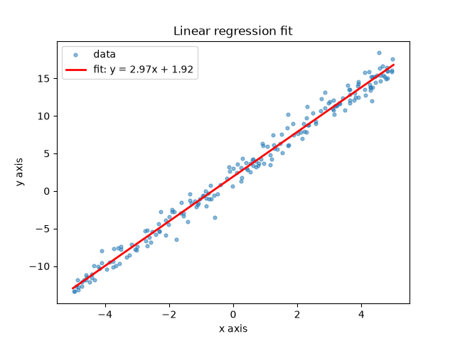

##Linear regression from scratch
Trained with hand derived gradient descent in raw numpy.

#Formulas:
e = (wx + b - y)
change in loss per change in weight = 1/n * sum(2 * e * x)
change in loss per change in bias  = 1/n * sum(2 * e)

the x is in the weight and not the loss formula beacuse when you derive out e using the chain rule on w, x comes out as its multiplier
but b has no multiplier, so it comes out as 1

#Results:
Using a dataset where y = 3x + 2 + noise(normal distribution with mean of 0 and spread of 1)
100 steps of gradient descent learned that w should be ~2.97 and b should be 1.92
this is because of the seed value for the random numbers, and will change if a different seed is used
the trained w and b match NumPy’s exact least-squares solution (np.polyfit) to 15 digits

#Images:

#How to Run:
$ uv run regression.py
$ uv run pytest

#What I Learned:
Matplot graphing and images
Gradient exploding
Scalar noise adds a loss floor
